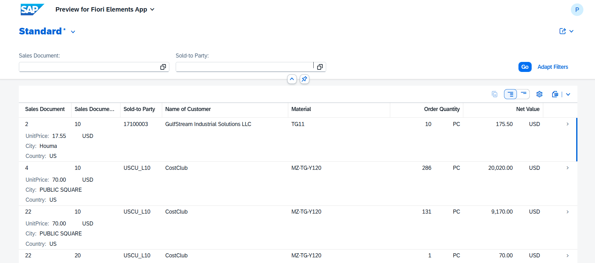

# ABAP CDS Practice: Sales Order Item Overview

A learning project built on an SAP S/4HANA trial system using **ABAP Cloud** (clean core) rules. It models a Sales Order Item overview as a layered CDS stack and exposes it as an OData V4 service with a Fiori Elements list report, with no custom UI code.

## What this project demonstrates

- **Layered CDS design (VDM style):** interface layer (`ZI_`) for the data model, consumption layer (`ZC_`) for UI concerns.
- **ABAP Cloud / clean core:** only released SAP views are used (`I_SalesDocumentItem`, `I_Customer`). Direct table access (e.g. `VBAK`) is blocked in a cloud-language-version package.
- **Exposed association:** `_Customer` is declared once and reused. Customer name, city and country are read through path expressions, which behave like a left outer join. Orders without a customer are kept, not dropped.
- **Safe calculation:** `UnitPrice = NetAmount / OrderQuantity` with zero-quantity handling (`CASE`) and explicit casting (`CURR`/`QUAN` to `DEC`, then back to `CURR` with a currency link).
- **Semantics annotations:** `@Semantics.amount.currencyCode` and `@Semantics.quantity.unitOfMeasure`.
- **UI annotations:** `@UI.lineItem`, `@UI.selectionField`, `@Search.defaultSearchElement`, `@EndUserText.label`.
- **Service layer:** Service Definition plus Service Binding (OData V4 - UI), previewed as a Fiori Elements app.

## Architecture

    I_SalesDocumentItem, I_Customer   (SAP released views)
              |
    ZI_SALESORDERITEM_OV              (interface view: keys, association, UnitPrice)
              |
    ZC_SALESORDERITEM_OV              (consumption view: UI annotations)
              |
    ZSD_SALESORDERITEM_OV             (service definition: expose as SalesOrderItem)
              |
    ZSB_SALESORDERITEM_OV_UI          (service binding: OData V4 - UI)

## Repository structure

| Folder | Content |
|---|---|
| `cds/` | CDS view entities (`ZI_`, `ZC_`) |
| `service/` | Service definition |
| `metadata/` | Metadata Extension |
| `screenshots/` | Fiori Elements preview |

## Key design decisions

- **Left outer behaviour over inner join:** a missing customer is a data quality issue that should stay visible in reporting, not silently remove the order.
- **Zero quantity returns 0 for UnitPrice:** keeps the view from failing at runtime. In a real project I would confirm with the business whether "undefined" should be 0 or NULL.
- **UI annotations kept out of the interface view:** the same `ZI_` view can serve other apps or APIs without being tied to one UI.

## Screenshots

## Environment

- SAP S/4HANA trial system
- ABAP Development Tools (Eclipse)
- Package language version: ABAP for Cloud Development

## Roadmap

- [ X ] Metadata Extension (move UI annotations out of the CDS view)
- [ X ] Object Page (`@UI.facet`, field groups)
- [ ] Text associations with `@ObjectModel.text`
- [ ] Access control (DCL)
- [ ] RAP managed scenario with custom table (create, update, delete, validations)
- [ ] ABAP Unit tests
- [ ] SAP BTP side-by-side app with Generative AI Hub
